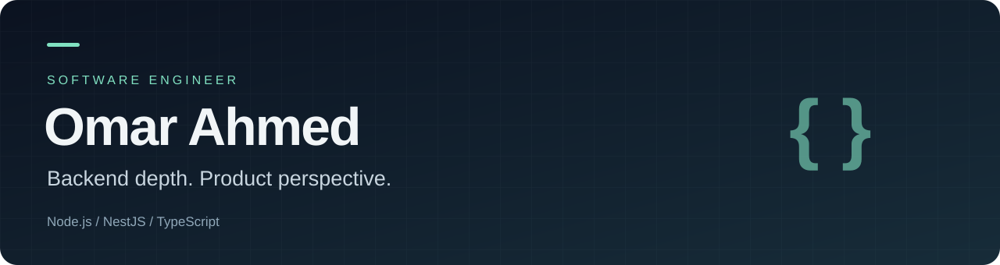

  <a href="https://omarahmedowais.github.io/"><strong>Portfolio</strong></a> ·
  <a href="https://omarahmedowais.github.io/Omar-Ahmed-Resume.pdf">Resume</a> ·
  <a href="https://www.linkedin.com/in/omar-ahmed-owais-abdel-tawab-13a09b1b2/">LinkedIn</a> ·
  <a href="mailto:omar.owais.dev@gmail.com">Email</a>

## Building the services behind useful products

I'm **Omar Ahmed**, a software engineer from Egypt with **3 years of experience**, focused on **Node.js, NestJS, and TypeScript**. I build APIs, modular backends, and real-time experiences, with frontend experience that helps me connect technical decisions to the people using the product.

Currently a **Node.js Developer at Raise Right**, contributing to EduMarket. My work spans education, sports booking, property platforms, and multi-tenant SaaS.

### Selected product contributions

These are commercial products I've contributed to; their source code belongs to their respective teams.

| Product | What I contributed |
| --- | --- |
| [**EduMarket ↗**](https://edumarket.io/) | Contributed to a 58-module NestJS backend rebuild: **6.8× throughput**, **~6× lower p95 latency**, and **~0% HTTP failures** in a 300-concurrent-user load test. |
| [**Spark ↗**](https://sparkplatform.app/) | Backend services and integrations for sports and activity bookings, including real-time availability and notifications. |
| [**Views ↗**](https://views.properties/en) | APIs for listings, reservations, search, and notifications on a multilingual property platform. |
| [**Jam3ty ↗**](https://jam3ty.net/) | Learning workflows covering courses, enrollment, content, student progress, and assessments. |

[**Explore project previews and my experience →**](https://omarahmedowais.github.io/#work)

### EduMarket: the results behind the work

| Measure | Before → after |
| --- | --- |
| **Throughput** | 4.85 → **32.8 requests/second** (6.8×) |
| **p95 response time** | 60s → **9.9s** (~6× lower) |
| **HTTP failure rate** | 79.5% → **~0%** |
| **Enrollment & wallet success** | 0% → **100%** |
| **Circular module dependencies** | 41 → **0** |

Performance and flow-success figures come from before/after load tests with **300 concurrent users**.

<strong>Architecture, optimization & reliability</strong>

- Contributed across **58 NestJS modules** using CQRS, hexagonal architecture and DDD, exposing GraphQL and REST interfaces.
- Used **pg_stat_statements**, targeted PostgreSQL indexes, DataLoader batching and tag-based Redis caching to address sequential scans and N+1 queries. Top queries fell from **6–15 seconds to sub-millisecond**, with a measured **99.9% cache-hit rate**.
- Integrated **Kashier and Paymob** behind circuit breakers, alongside wallet and installment workflows.
- Removed circular dependencies and added **dependency-cruiser** checks before commits and pushes.
- Backed reliability with **3,000+ automated tests across 428 Jest/Testcontainers suites**, plus **23 k6 scenarios**: a **20→200 RPS spike** and a **45-minute soak at 15 RPS**. Used Sentry, Prometheus and Loki for observability.

The **1,000,000-user dataset was seeded test data**, not a claim of active production users.

### My toolkit

| Area | Technologies |
| --- | --- |
| **Backend** | Node.js · NestJS · Express · TypeScript · JavaScript · GraphQL · REST |
| **Data & real-time** | PostgreSQL · MongoDB · Redis · SQL Server · Socket.io |
| **Frontend** | React · Angular · Redux Toolkit · RTK Query |
| **Delivery** | Docker · Git · AWS · Azure · Google Cloud |

### Experience

- **Raise Right** — Node.js Developer · June 2025–present
- **Apes Smart Solutions** — Node.js Developer, part-time · February–December 2025
- **Sarri Technology** — MERN Stack Developer · October 2023–May 2025
- **CustEx** — Backend Developer, part-time · August–November 2023

B.Sc. in Computer Science, Artificial Intelligence — **Fayoum University**, 2023.

### Let's connect

Have a backend challenge, a product idea, or an engineering opportunity?  
Reach me at **[omar.owais.dev@gmail.com](mailto:omar.owais.dev@gmail.com)** or connect on **[LinkedIn](https://www.linkedin.com/in/omar-ahmed-owais-abdel-tawab-13a09b1b2/)**.

<strong>نبذة بالعربية</strong>

أنا **عمر أحمد**، مهندس برمجيات من مصر، أركز على تطوير الأنظمة الخلفية باستخدام **Node.js وNestJS وTypeScript**. لدي خبرة في بناء واجهات برمجة التطبيقات، والأنظمة متعددة المستأجرين، والتحديثات الفورية، مع خبرة في تطوير الواجهات الأمامية باستخدام React وAngular.

ساهمت في منتجات في مجالات التعليم، وحجز الأنشطة الرياضية، والعقارات. يمكنك استكشاف مشاريعي وخبراتي عبر [معرض أعمالي بالعربية والإنجليزية](https://omarahmedowais.github.io/)، أو التواصل معي عبر [البريد الإلكتروني](mailto:omar.owais.dev@gmail.com).

